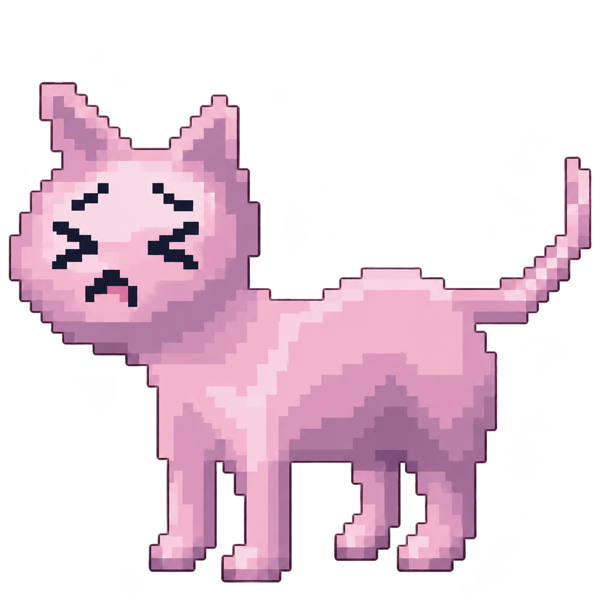

<p align="center">
  
</p>

<h1 align="center">Hit P-Chan!</h1>

<p align="center">Un pequeño juego pixel art con una estética kawaii rosa y un final inquietante.</p>
<p align="center">Creado por <a href="https://x.com/xergno">Xergno</a>.</p>

## El juego

Escribe tu nombre y comienza a jugar. Cada clic o toque sobre la parte visible de P-Chan cuenta como un golpe. El fondo y los márgenes transparentes no cuentan.

- Diseño adaptable a móviles, tablets y escritorio, en vertical y horizontal.
- Cursor con mano, martillo y cuchillo; en pantallas táctiles, el arma aparece brevemente sobre el toque.
- Sprites de impacto sincronizados, partículas y animaciones suaves.
- Quince frases personalizadas con tu nombre, en burbujas redondeadas que flotan. Aparecen cada 50 golpes y duran 15 segundos; después de la última frase, el ciclo vuelve a empezar.
- Español, inglés y japonés, con fuentes incluidas localmente.
- Diálogos de desbloqueo que detienen los golpes hasta pulsar «Continuar».
- Pantalla final con texto progresivo y opción de jugar nuevamente.
- Controles de teclado, gestión del foco y respeto a la preferencia de movimiento reducido.

### Progresión

El arma y el sprite de P-Chan cambian por separado:

| Golpes acumulados | Arma | Sprite de P-Chan | Evento |
| --- | --- | --- | --- |
| 0–499 | Mano | Fase 01 | — |
| 500–549 | Martillo | Fase 01 | Desbloqueo del martillo en 500 |
| 550–999 | Martillo | Fase 02 | Cambio de personaje en 550 |
| 1000–1049 | Cuchillo | Fase 02 | Desbloqueo del cuchillo en 1000 |
| 1050–1499 | Cuchillo | Fase 03 | Cambio de personaje en 1050 |
| 1500 | — | Pantalla final | Fase 04 |

### Datos guardados

El nombre y el idioma se guardan en `localStorage`. Las partidas incompletas se reinician al recargar: no se conserva el contador ni los desbloqueos. Si llegas al final, ese estado sí se guarda y reaparece al recargar.

«Jugar nuevamente» borra el final y reinicia la partida, conservando tu nombre y el idioma. No hay backend, cuentas, base de datos ni servicios externos. Los datos se mantienen en el navegador de cada persona y son independientes para cada dominio.

## Instalación local

Requiere Node.js 24 y npm. También son compatibles Node.js 22.12 o posterior de la rama 22 y Node.js 26.

```bash
git clone https://github.com/vx66/hit-pchan.git
cd hit-pchan
npm ci
npm run dev
```

Abre la dirección que indique Vite, normalmente `http://127.0.0.1:5173`.

Para probarlo desde un móvil o tablet en la misma red Wi-Fi:

```bash
npm run dev:network
```

Abre en el dispositivo la dirección `Network` que imprima Vite.

### Comprobaciones y versión de producción

```bash
npm run typecheck
npm test
npm run build
npm run preview
```

La compilación se genera en `dist/` y puede servirse con un servidor de archivos estáticos. `preview` permite revisarla localmente.

Las pruebas de navegador requieren instalar los navegadores de Playwright:

```bash
npx playwright install chromium firefox
npm run test:browser
```

En Linux, Playwright puede indicar que faltan bibliotecas del sistema. Las pruebas cubren ratón, interacción táctil, umbrales, diálogos, recarga, final, ciclo de frases y diseño sin superposiciones en móviles, tablets y escritorio. Son pruebas con dispositivos simulados.

## Ejecutar con Docker

Con Docker y Docker Compose instalados, puedes ejecutar el juego sin instalar Node.js en tu equipo. Desde la carpeta del repositorio clonado:

```bash
docker compose -f docker-compose.yml -f docker-compose.local.yml up -d --build
```

Abre `http://127.0.0.1:8080`. Para comprobar la salud y consultar los registros:

```bash
curl --fail http://127.0.0.1:8080/healthz
docker compose -f docker-compose.yml -f docker-compose.local.yml logs -f
```

Para detenerlo:

```bash
docker compose -f docker-compose.yml -f docker-compose.local.yml down
```

El `Dockerfile` instala las dependencias, ejecuta las pruebas unitarias y compila en una primera etapa. La imagen final utiliza Nginx para servir el juego en el puerto interno **80**, con una comprobación de salud en `/healthz`. No necesita variables de entorno, volúmenes ni una base de datos.

`docker-compose.yml` define el servicio `hit-pchan` para plataformas que gestionan el dominio y el acceso al contenedor. `docker-compose.local.yml` añade únicamente el acceso local en el puerto 8080. El archivo principal utiliza construcción desde el código fuente y requiere Docker Compose; para Docker Stack sería necesario publicar primero una imagen.

## Estructura

```text
├── Dockerfile                 # Construcción y servidor de producción
├── docker-compose.yml         # Servicio para despliegue
├── docker-compose.local.yml   # Puerto para uso local
├── .dockerignore              # Exclusiones para la imagen
├── deploy/nginx.conf          # Recursos estáticos, caché y salud
├── public/                    # Favicon y sprites que sirve la aplicación
├── sprites/                   # PNG originales, sin modificaciones
├── src/
│   ├── components/            # Pantallas, cursor, diálogos y burbujas
│   ├── game/                  # Lógica, umbrales y almacenamiento
│   ├── i18n/                  # Textos y frases en los tres idiomas
│   └── styles/                # Estética pixel art y diseño adaptable
├── tests/                     # Pruebas unitarias y de navegador
└── package-lock.json          # Dependencias fijadas para npm ci
```

La carpeta `curors` conserva su nombre original. Los archivos de `public/sprites/` son copias idénticas de los originales; las pruebas comprueban que no se hayan alterado.

`node_modules/`, `dist/`, los resultados de pruebas, las variables de entorno y las carpetas locales de herramientas quedan excluidos de Git y del contexto Docker cuando corresponde.
